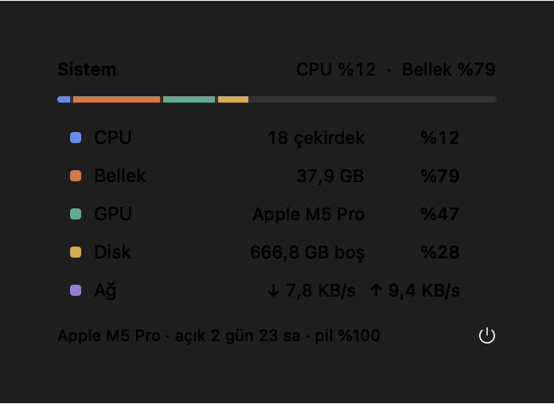
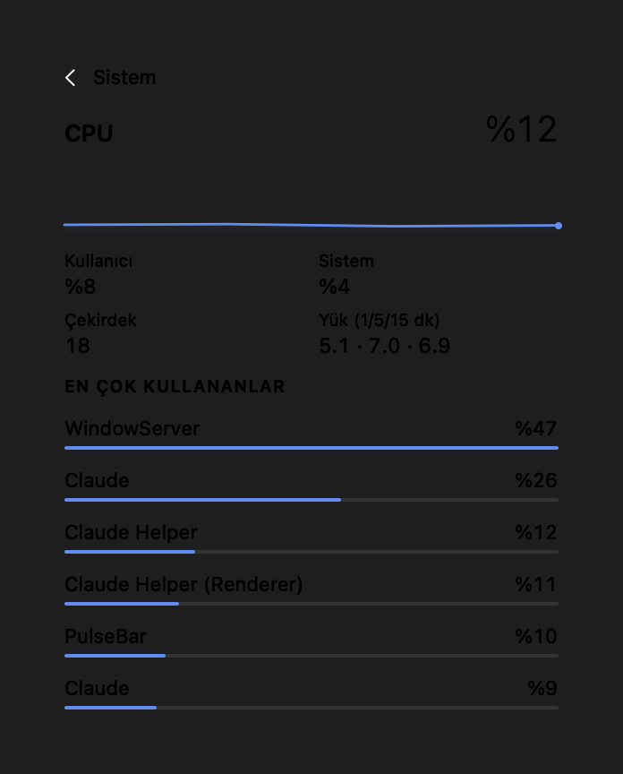

# PulseBar

A small, glass-style system monitor for the macOS menu bar. CPU, memory, GPU, disk and network at a glance; click any row to see what is using it.

<p align="center">
  
  
</p>

[Türkçe](README.tr.md)

## Features

- **Overview panel:** CPU, memory, GPU, disk and network in one compact panel with a combined usage bar.
- **Details on click:** history graph, breakdown (user/system, app/wired/compressed, read/write, up/down) and the top processes for that category.
- **Disk volumes:** free space for every mounted writable volume.
- **System info:** chip, uptime, battery.
- Liquid Glass design, light and dark mode. Lives only in the menu bar (no Dock icon).
- No network access, no telemetry, no third-party dependencies.

## Requirements

- macOS 26 (Tahoe) or later, Apple Silicon
- Xcode 26 / Swift 6.2 to build

## Install

Build from source:

```sh
git clone https://github.com/efehascan/PulseBar.git
cd PulseBar
scripts/make-app.sh            # creates dist/PulseBar.app
open dist/PulseBar.app
```

Move `dist/PulseBar.app` to `/Applications` to keep it. To start it at login: System Settings → General → Login Items → add PulseBar.

The app is ad-hoc signed, not notarized. If you download a build instead of compiling it, right-click → Open the first time.

## Development

```sh
swift run PulseBar                                  # run in debug
scripts/check.sh                                    # build + tests (compact output)
scripts/check.sh FormattingTests                    # only one test group
.build/debug/PulseBar --snapshot panel.png [--dark] [--detail cpu]   # render the panel to PNG
```

- `Sources/PulseBarCore/`: monitors and data model (no UI, fully tested).
- `Sources/PulseBar/`: SwiftUI menu bar UI.
- `docs/map/pulsebar.md`: architecture notes.

The interface text is currently in Turkish.

## How it was built

PulseBar was built by one developer with AI agents: Claude designed the skeleton and reviewed the work, a local Qwen model wrote most of the files, and every change was gated by the build, tests and a second local model's review.

## License

[MIT](LICENSE)
